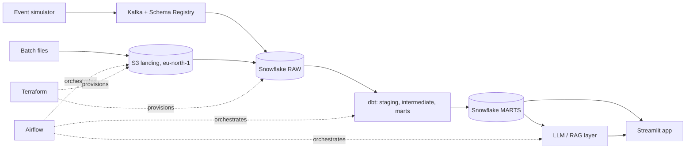

# Architecture

## Components
| Layer | Tool | Role |
|---|---|---|
| Infrastructure | Terraform | AWS and Snowflake resources as code |
| Streaming | Kafka | Real-time app events |
| Warehouse | Snowflake | RAW, STAGING, MARTS |
| Transformation | dbt | Models, tests, docs |
| Orchestration | Airflow | Batch loads, dbt runs, quality checks |
| AI | LLM / RAG | Text-to-SQL and retrieval over marts and docs |
